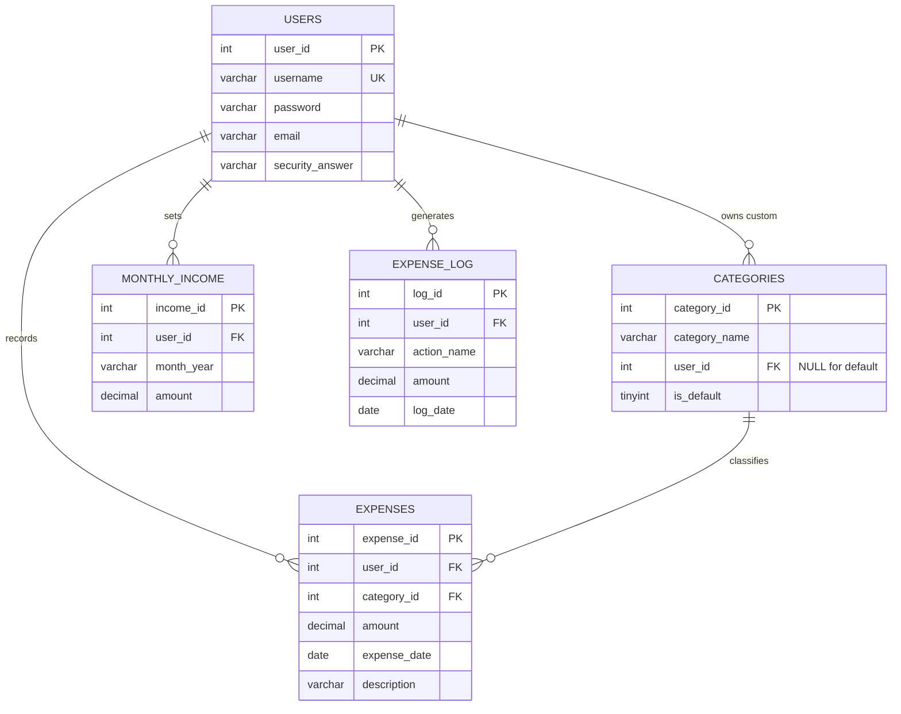

# VIVA NOTES - ExpenseEase

## 1. The project in plain English

This is a desktop expense tracker. A person registers with a username,
password, email and a security answer. The password is stored as plain text
because hashing is not part of the syllabus.

After login, the app asks for the income of the current month if it is not
already saved. The dashboard then shows three cards (total income, total spent,
savings), a table of all expenses, and buttons to add, edit or delete an
expense, add a custom category, change the monthly income, export Excel and log
out.

Every expense belongs to a category. There are 11 default categories shared by
all users, and a user can add private categories. Only the latest 5 months of
data are kept. On login, the app checks for older rows with SQL date functions.
If old rows exist, it asks whether to export first, then calls the stored
procedure to delete them.

The Excel export writes one block for each month, newest month first. Each
block contains the date, category, description and amount of every expense,
followed by the month total, the income and the savings (income - total spent).
A grand total block is added at the end.

## 2. ER diagram



ASCII version:

```text
USERS (1) ----< (M) CATEGORIES
USERS (1) ----< (M) EXPENSES
USERS (1) ----< (M) MONTHLY_INCOME
USERS (1) ----< (M) EXPENSE_LOG
CATEGORIES (1) ----< (M) EXPENSES
```

- One user can have many expenses, incomes and custom categories.
- One category can be used by many expenses.
- `categories.user_id` is NULL for a default category. A NULL means the
  category is shared by everyone.
- `expense_log` is an audit table. It stores a copy of the deleted expense's
  amount because the original expense row no longer exists.

## 3. Why the database is in 3NF

### First Normal Form (1NF)

Every column has one atomic value. There are no repeating groups and no lists
inside a column. Each expense is one row. Each category is one row. A date is
one value in a `DATE` column.

### Second Normal Form (2NF)

Every table has a single-column primary key (`user_id`, `category_id`,
`expense_id`, `income_id`, `log_id`), so there is no partial dependency on part
of a composite key. `monthly_income` also has the candidate key
`(user_id, month_year)`, and its `amount` depends on both the user and the
month, not on only one of them.

### Third Normal Form (3NF)

There is no transitive dependency:

- `expenses` stores `category_id`, not `category_name`. The name is stored only
  in `categories`.
- `expenses` stores `user_id`, not `username`. The username is stored only in
  `users`.
- `monthly_income` stores only `user_id`, `month_year` and `amount`.
- `expense_log` stores the amount as a historical snapshot. This is intentional
  because the original expense row is deleted; it is not a transitive
  dependency between two non-key columns.

`expense_details_view` is a view, not a table. It joins expenses and categories
so the category name can be shown without storing it twice.

## 4. Concept -> file where it is used

### Java / OOP concepts

| Concept | File where it is used |
| --- | --- |
| Control structures (`if/else`, `for`, `while`) | `ExpenseService`, `DashboardPanel`, `XlsxExporter` |
| Arrays | `DashboardPanel.createButtonBar` (`JButton[]`), `Main.main` (`String[] args`) |
| Strings | all classes; `XlsxExporter` builds the report |
| StringBuffer | `XlsxExporter.createSheet`, `XlsxExporter.addMonth` |
| Classes and objects | `model/User`, `model/Expense`, `model/Category` |
| Constructors and `this` | all three model classes, `ExpenseDialog` |
| Inheritance | `BasePanel` -> four screen panels; `MainFrame extends JFrame`; `ExpenseDialog extends JDialog` |
| Method overriding | `resetForm()` and `actionPerformed()` in the UI; `toString()` in the models |
| Abstract class | `ui/BasePanel.java` |
| Object class `toString()` | `model/User.java`, `model/Expense.java`, `model/Category.java` |
| Packages | `model`, `exception`, `service`, `ui` |
| Access modifiers | `private` model fields; `protected` helpers in `BasePanel` |
| Interface with default + static method | `service/Exportable.java` |
| try / catch / throw / throws / finally | services throw; UI catches; `finally` in `DBConnection.closeAll` |
| User-defined exceptions | `exception/InvalidInputException.java`, `exception/LoginFailedException.java` |
| File I/O with `FileOutputStream` / `ZipOutputStream` | `XlsxExporter.writeFile` |
| ArrayList | `ExpenseService.listExpenses`, `DashboardPanel.refreshDashboard` |
| HashSet | `CategoryService.addCustomCategory`, `XlsxExporter.getMonths` |
| HashMap | `IncomeService.getMonthlyIncomeMap`, `ExpenseService.getMonthlySpentMap`, `XlsxExporter` |
| Lambda | `Main.main` (`SwingUtilities.invokeLater(() -> ...)`) |
| JDBC `Connection` | `DBConnection.getConnection` |
| JDBC `PreparedStatement` | all service classes |
| JDBC `ResultSet` | all service read methods |
| JDBC `CallableStatement` | `ExpenseService.deleteOldData` |

### DBMS concepts

| Concept | File where it is used |
| --- | --- |
| DDL (`CREATE`, `DROP`) | `sql/schema.sql` |
| DML (`INSERT`, `UPDATE`, `DELETE`) | service classes and `sql/sample_data.sql` |
| COMMIT / ROLLBACK | `UserService.register`, `ExpenseService.deleteOldData` |
| SELECT with WHERE | all service read methods |
| SELECT with GROUP BY | `ExpenseService.getMonthlySpentMap` |
| SELECT with ORDER BY | `ExpenseService.listExpenses` |
| Primary key | all 5 tables in `sql/schema.sql` |
| Foreign key | `categories.user_id`, `expenses.user_id`, `expenses.category_id`, `monthly_income.user_id`, `expense_log.user_id` |
| NOT NULL | `sql/schema.sql` |
| UNIQUE | `users.username`, `categories(user_id, category_name)`, `monthly_income(user_id, month_year)` |
| CHECK | `amount > 0`, `is_default IN (0, 1)` |
| DEFAULT | `categories.is_default DEFAULT 0` |
| JOIN | `expense_details_view` in `sql/schema.sql` |
| Aggregate `SUM` | `ExpenseService.getTotalSpent`, `IncomeService.getTotalIncome`, `ExpenseService.getMonthlySpentMap` |
| View | `expense_details_view` |
| Normalization up to 3NF | `sql/schema.sql`, section 3 of this file |
| ER diagram | section 2 of this file |
| Stored procedure | `sp_delete_old_data` in `sql/schema.sql` |
| Trigger | `trg_expense_after_delete` in `sql/schema.sql` |

### Swing concepts

| Concept | File where it is used |
| --- | --- |
| `JFrame` | `MainFrame` |
| `JPanel` | `BasePanel` and every screen panel |
| `JLabel` | `BasePanel.createLabel`, `BasePanel.createTitle` |
| `JTextField` | `BasePanel.createTextField` |
| `JPasswordField` | `BasePanel.createPasswordField` |
| `JButton` | `BasePanel.createButton` |
| `JComboBox` | `ExpenseDialog.categoryBox` |
| `JTable` | `DashboardPanel.createTablePanel` |
| `JOptionPane` | all UI classes for messages and input |
| `JFileChooser` | `DashboardPanel.doExport` |
| `JDialog` | `ExpenseDialog` |
| `CardLayout` | `MainFrame` |

## 5. JDBC flow step by step

1. **Load the driver** - `DBConnection` has a static block:
   `Class.forName("com.mysql.cj.jdbc.Driver")`.
2. **Connect** - `DriverManager.getConnection(URL, USER, PASSWORD)` returns a
   `Connection`.
3. **Create a PreparedStatement** -
   `con.prepareStatement("INSERT INTO expenses (...) VALUES (?, ?, ?, ?, ?)")`.
4. **Set the values** - `ps.setInt`, `ps.setString`, `ps.setDouble`.
5. **Execute** - `ps.executeQuery()` for SELECT, `ps.executeUpdate()` for
   INSERT/UPDATE/DELETE.
6. **Read the ResultSet** - `while (rs.next())` and `rs.getInt`,
   `rs.getString`, `rs.getDouble`.
7. **Close resources** - the `finally` block calls
   `DBConnection.closeAll(con, ps, rs)`, which closes the ResultSet first, then
   the statement, then the connection.
8. **Call the procedure** - `ExpenseService.deleteOldData` uses
   `con.prepareCall("{call sp_delete_old_data(?)}")`, `cs.setInt(1, userId)`,
   `cs.execute()`, then `commit()`.
9. **Transaction** - `con.setAutoCommit(false)` before the work, `con.commit()`
   after success, `con.rollback()` in the catch block.

## 6. The trigger

```sql
CREATE TRIGGER trg_expense_after_delete
AFTER DELETE ON expenses
FOR EACH ROW
BEGIN
    INSERT INTO expense_log (user_id, action_name, amount, log_date)
    VALUES (OLD.user_id, 'DELETE', OLD.amount, CURDATE());
END;
```

- It fires automatically after a row is deleted from `expenses`.
- `OLD` means the row that was just deleted.
- It writes the user, the action name, the old amount and today's date into
  `expense_log`.
- It fires when the user deletes one expense in the app, and also when the
  stored procedure deletes old expenses.
- Check it with `SELECT * FROM expense_log;`.

## 7. The stored procedure

```sql
CREATE PROCEDURE sp_delete_old_data(IN p_user_id INT)
BEGIN
    DELETE FROM expenses
    WHERE user_id = p_user_id
      AND expense_date < DATE_SUB(CURDATE(), INTERVAL 5 MONTH);

    DELETE FROM monthly_income
    WHERE user_id = p_user_id
      AND month_year < DATE_FORMAT(DATE_SUB(CURDATE(), INTERVAL 5 MONTH), '%Y-%m');
END;
```

- `IN p_user_id` is the input parameter.
- `CURDATE()` is today's date.
- `DATE_SUB(CURDATE(), INTERVAL 5 MONTH)` is the date 5 months ago.
- Expenses before that date are deleted.
- `month_year` is text like `2026-10`, so it is compared with the formatted
  cutoff month.
- Java calls it with a `CallableStatement` inside a transaction.

## 8. The view

```sql
CREATE VIEW expense_details_view AS
SELECT e.expense_id, e.user_id, e.category_id, c.category_name,
       e.amount, e.expense_date, e.description
FROM expenses e
JOIN categories c ON e.category_id = c.category_id;
```

- A view is a saved SELECT query that looks like a table.
- It joins `expenses` and `categories`, so the category name is available
  without writing the JOIN in every query.
- `ExpenseService.listExpenses` and `findExpense` read from this view.
- The view does not store data; it is calculated from the two tables.

## 9. Commit and rollback

`UserService.register`:

```java
con.setAutoCommit(false);
// INSERT INTO users ...
con.commit();
```

If an `SQLException` happens, the catch block calls `con.rollback()`. This
means the user row is either saved completely or not saved at all.

`ExpenseService.deleteOldData` does the same around the stored procedure call:
both the expenses and the income rows are deleted in one transaction. If the
procedure fails, the rollback puts everything back.

## 10. How the Excel (.xlsx) file is written

`XlsxExporter` implements `Exportable` and builds the file by hand:

1. `expenseService.listExpenses(userId)` gets all expense rows.
2. `incomeService.getMonthlyIncomeMap(userId)` gets month -> income.
3. `expenseService.getMonthlySpentMap(userId)` gets month -> total spent using
   `GROUP BY`.
4. A `HashSet` collects all months. `Collections.sort` and
   `Collections.reverse` put the newest month first.
5. For each month a `StringBuffer` adds a month heading, a column header row,
   one row per expense, then the month total, income and savings.
6. A grand total block is added at the end.
7. `Exportable.escapeXml` replaces `&`, `<`, `>` and `"` inside every text cell.
8. An XLSX file is a zip of small XML files. `ZipOutputStream` writes
   `[Content_Types].xml`, `_rels/.rels`, `xl/workbook.xml`,
   `xl/_rels/workbook.xml.rels`, `xl/styles.xml` and
   `xl/worksheets/sheet1.xml`.
9. `styles.xml` defines the green heading colours, bold text and the
   `Rs. #,##0.00` money format.
10. The `finally` block closes the zip.

The sheet looks like this:

```text
Expense Report - aditi
Generated on 2026-11-01

NOVEMBER 2026
Date        Category  Description      Amount
2026-11-05  Food      Lunch            Rs. 250.00
2026-11-03  Travel    Bus              Rs. 40.00
                        Month Total  Rs. 290.00
                     Monthly Income  Rs. 30,000.00
                            Savings  Rs. 29,710.00

OCTOBER 2026
...
```

Savings is calculated as `income - totalSpent` for that month. No Excel
library is used; only `java.util.zip` from the JDK.

## 11. One line about each class

| Class | What it does |
| --- | --- |
| `Main` | Sets the look and feel and opens `MainFrame`. |
| `User` | Model for one row of the `users` table. |
| `Expense` | Model for one row of the `expenses` table. |
| `Category` | Model for one row of the `categories` table; `toString()` is the dropdown text. |
| `InvalidInputException` | User-defined checked exception for bad input. |
| `LoginFailedException` | User-defined checked exception for a failed login or password reset. |
| `DBConnection` | Holds the hard-coded database settings, loads the driver and closes resources. |
| `UserService` | Does register, login and forgot password SQL. |
| `ExpenseService` | Does add, edit, delete, list, totals, old-data check and the procedure call. |
| `CategoryService` | Lists default + custom categories and adds a custom category. |
| `IncomeService` | Sets and reads the monthly income and total income. |
| `Exportable` | Interface with `exportData`, a default `getFileType` and a static `escapeXml`. |
| `XlsxExporter` | Implements `Exportable` and writes the Excel report. |
| `AppColors` | All light green colour constants. |
| `BasePanel` | Abstract `JPanel` parent with shared fonts, buttons, fields and `resetForm`. |
| `LoginPanel` | Login screen. |
| `RegisterPanel` | Register screen. |
| `ForgotPasswordPanel` | Forgot password screen. |
| `DashboardPanel` | Top bar, three cards, expense table, action buttons and `refreshDashboard`. |
| `ExpenseDialog` | Modal dialog used for both adding and editing an expense. |
| `MainFrame` | `JFrame` with `CardLayout` that switches the four screens. |

## 12. Twenty-five likely viva questions

**1. What is JDBC?**
JDBC is the Java API for talking to a database. The steps are: load the driver,
open a connection, create a statement, execute SQL, read the result and close
everything.

**2. Which JDBC classes does your project use?**
`DriverManager`, `Connection`, `PreparedStatement`, `CallableStatement`,
`ResultSet` and `SQLException`.

**3. Why do you use `PreparedStatement` instead of `Statement`?**
It uses `?` placeholders, sets values safely and prevents SQL injection. The
database can also reuse the prepared query.

**4. Where do you use `CallableStatement`?**
In `ExpenseService.deleteOldData`, to call `sp_delete_old_data(?)`.

**5. What is a `ResultSet`?**
It is the table of rows returned by a SELECT. `rs.next()` moves to the next row
and `rs.getString()` / `rs.getDouble()` read a column.

**6. What is a trigger and what does yours do?**
A trigger is a stored program that runs automatically when a table changes.
Our trigger runs `AFTER DELETE` on `expenses` and inserts the old user id, the
action `DELETE`, the old amount and `CURDATE()` into `expense_log`.

**7. What is a stored procedure and what does yours do?**
A named SQL program saved in the database. `sp_delete_old_data(IN p_user_id)`
deletes that user's expenses and income older than 5 months.

**8. What is a view and why do you use one?**
A view is a saved SELECT that looks like a table. `expense_details_view` joins
`expenses` and `categories`, so the category name is easy to read.

**9. What is 3NF?**
1NF means atomic values, 2NF means no partial dependency on part of a key, and
3NF means no transitive dependency between non-key columns.

**10. Is your schema in 3NF, and why is `categories.user_id` NULL?**
Yes. Category names are only in `categories`, usernames only in `users`, and
expenses use foreign keys. A NULL `user_id` means a default category shared by
everyone; a number means a custom category owned by that user.

**11. What is a foreign key, and what is the difference between PRIMARY KEY and UNIQUE?**
A foreign key points to the primary key of another table, for example
`expenses.user_id` -> `users.user_id`. A primary key identifies each row and
cannot be NULL. UNIQUE also stops duplicates, but a table can have several
UNIQUE columns and MySQL allows NULL in them.

**12. What do CHECK and DEFAULT do?**
CHECK rejects bad values, for example `amount > 0`. DEFAULT supplies a value
when the INSERT does not give one, for example `is_default DEFAULT 0`.

**13. What are commit, rollback and `setAutoCommit(false)`?**
COMMIT saves all changes of a transaction. ROLLBACK cancels the uncommitted
changes. `setAutoCommit(false)` groups several statements into one transaction.
We use them in `UserService.register` and `ExpenseService.deleteOldData`.

**14. What is inheritance in your project?**
`BasePanel` is the parent of `LoginPanel`, `RegisterPanel`,
`ForgotPasswordPanel` and `DashboardPanel`. `MainFrame` extends `JFrame` and
`ExpenseDialog` extends `JDialog`.

**15. What is an abstract class?**
A class that cannot be created directly and can have abstract methods.
`BasePanel` is abstract and declares `resetForm()`, which every screen must
implement.

**16. What is an interface? What are default and static methods?**
An interface is a contract of methods. `Exportable` has `exportData`, a default
`getFileType()` that classes get for free, and a static `escapeXml()` helper.

**17. What is encapsulation?**
Keeping fields private and giving public getters and setters. The `User`,
`Expense` and `Category` classes do this.

**18. What is method overriding? Give an example.**
A subclass writes its own version of a parent method. The panels override
`resetForm()` and `actionPerformed()`, and the model classes override
`toString()`.

**19. How do you handle exceptions and close resources?**
Services throw `InvalidInputException`, `LoginFailedException` or
`SQLException`. The UI catches them and shows a `JOptionPane`. The `finally`
block calls `DBConnection.closeAll` to close the ResultSet, statement and
connection.

**20. Why do you use ArrayList, HashMap and HashSet?**
`ArrayList` keeps the expense list, `HashMap` stores month -> amount, and
`HashSet` finds duplicate category names and collects the months for the Excel
report.

**21. How does the dashboard update instantly?**
`DashboardPanel.refreshDashboard()` clears the table model, adds all expenses
again and recalculates the three cards. It is called after every add, edit,
delete and income change.

**22. How does the 5-month deletion work?**
`hasOldData` uses `DATE_SUB(CURDATE(), INTERVAL 5 MONTH)`. If old rows exist,
the user is asked about exporting. Then `deleteOldData` calls the stored
procedure with a `CallableStatement` and commits.

**23. How is the Excel file written without a library?**
An `.xlsx` file is a zip of XML files. `XlsxExporter` uses a `StringBuffer` to
build the sheet XML, `Exportable.escapeXml` to escape special characters, and
`ZipOutputStream` to pack the parts into the `.xlsx` file. Each month block has
the expense rows, month total, income and savings.

**24. How does forgot password work?**
`UserService.forgotPassword` runs a SELECT with username, email and security
answer. If a row is found, it runs an UPDATE with the new password.

**25. What is CardLayout and which Swing components do you use?**
CardLayout shows one panel at a time; `MainFrame` uses it to switch between
Login, Register, Forgot Password and Dashboard. We use `JFrame`, `JPanel`,
`JLabel`, `JTextField`, `JPasswordField`, `JButton`, `JComboBox`, `JTable`,
`JOptionPane`, `JFileChooser` and `JDialog`.

## 13. Suggested demo order

1. Show `sql/schema.sql` and run it in MySQL.
2. Show the 5 tables, trigger, procedure and view with `SHOW TABLES;` and
   `SHOW CREATE PROCEDURE sp_delete_old_data;`.
3. Login as `aditi` / `pass123`. Show the old-data export prompt.
4. Show the three cards and the table.
5. Add a custom category, then add an expense with it.
6. Edit the expense and show the cards change.
7. Delete an expense, then run `SELECT * FROM expense_log;` to show the trigger.
8. Export Excel and open the `.xlsx` file.
9. Logout, use Forgot Password, then login with the new password.
10. Run `SELECT * FROM expense_details_view;` to show the view.
